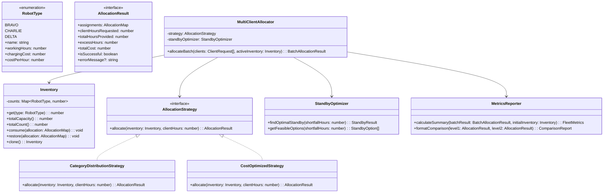

# EverBot Solutions: Robot Work Allocation System
## Senior Full Stack Engineer / Tech Lead Implementation Plan (Node.js & TypeScript)

---

### Executive Summary & Alignment with EverestEngineering

This project implements the **EverBot Robot Work Allocation System** using **Node.js & TypeScript**, strictly aligned with EverestEngineering’s evaluation criteria for a **Mid-Senior Full Stack Engineer**:
- **5+ Years Node.js & TypeScript Craftsmanship**: Strict type system (`strict: true`, zero `any`, branded types/enums, read-only immutable contracts).
- **Clean Architecture & SOLID Principles**:
  - **S**ingle Responsibility: Decoupled domain models, mathematical solvers, allocation strategies, multi-client queuing, and terminal I/O.
  - **O**pen/Closed: Easily extendable to new robot models or future allocation heuristics without modifying core engine logic.
  - **L**iskov Substitution: All strategies conform to a common `AllocationStrategy` interface.
  - **I**nterface Segregation: Fine-grained contracts for allocation, metrics aggregation, and inventory queries.
  - **D**ependency Inversion: High-level orchestrators depend on abstractions (`AllocationStrategy`), enabling seamless unit testing and mocking.
- **Zero Runtime Dependencies**: The core domain and CLI run entirely on native Node.js APIs (`readline`, `process`, `util`).
- **Test-Driven Development (TDD) via Vitest**: Comprehensive test coverage across all specification examples and boundary conditions.
- **CI/CD Automation**: GitHub Actions workflow (`.github/workflows/ci.yml`) enforcing type checking, linting, and 100% test pass on every commit.

---

### System Architecture & Class Diagram



---

### Proposed Package Audit Report

Per EverestEngineering engineering standards, zero unnecessary dependencies are introduced:

| Package | Type | Version | Purpose | Rationale / Alternatives Considered |
| :--- | :--- | :--- | :--- | :--- |
| **Node.js Standard Library** | Runtime | Built-in | CLI, I/O, events | Zero production dependencies for minimal footprint & vulnerability surface. |
| **typescript** | Dev | `^5.4.0` | Type checking & compilation | Industry standard for strict enterprise TypeScript. |
| **@types/node** | Dev | `^20.0.0` | Node.js typings | Accurate typings for Node.js standard modules. |
| **vitest** | Dev | `^1.6.0` | Fast TDD test runner | Native ESM and TypeScript support without bulky compilation overhead (preferred over Jest). |
| **tsx** | Dev | `^4.10.0` | TS runner for CLI dev | Instant native execution of TypeScript CLI files during local development. |

---

### Step-by-Step Task List

```markdown
- [ ] Task 1: Project Setup & TypeScript / Vitest Harness
  - [ ] Initialize `package.json`, `tsconfig.json` (strict mode), and `vitest.config.ts`
  - [ ] Configure npm scripts: `build`, `test`, `test:watch`, `test:coverage`, `start`
  - [ ] Create `.github/workflows/ci.yml` for automated CI validation
  - [ ] Git commit initial setup

- [ ] Task 2: Domain Layer & Custom Exceptions (TDD)
  - [ ] Write unit tests for `RobotType`, `Inventory`, and `DomainExceptions` (`tests/domain.test.ts`)
  - [ ] Implement `src/domain/models.ts`, `src/domain/inventory.ts`, `src/domain/exceptions.ts`
  - [ ] Verify validations (non-negative integers, immutability, cloning)

- [ ] Task 3: Level 1 - Category Distribution Strategy (TDD)
  - [ ] Write unit tests for Level 1 (`tests/level1.test.ts`) with slide test cases (16h, 17h, 21h, 24h)
  - [ ] Implement `CategoryDistributionStrategy` with bounded excess-hour minimization
  - [ ] Handle impossible allocation and capacity error edge cases

- [ ] Task 4: Level 2 - Cost-Optimized Strategy & Financial Comparison (TDD)
  - [ ] Write unit tests for Level 2 (`tests/level2.test.ts`) with slide test cases (20h -> $11, 6h -> $4)
  - [ ] Write financial comparison tests (Slide 10: $12 vs $11 with insight message)
  - [ ] Implement `CostOptimizedStrategy` (branch-and-bound optimization with tie-breaking)
  - [ ] Implement `FinancialComparisonService`

- [ ] Task 5: Level 3 - Standby Robot Activation (TDD)
  - [ ] Write unit tests for Level 3 (`tests/level3.test.ts`) with Slide 12 test case (16h active, 21h requested -> Charlie: 1 at $3)
  - [ ] Implement `StandbyOptimizer` with all feasible options enumerated and cost-optimal selection highlighted

- [ ] Task 6: Level 4 - Multi-Client Batch Allocation (TDD)
  - [ ] Write unit tests for multi-client processing with priority queue sorting (highest hours first)
  - [ ] Write tests for dynamic active inventory exhaustion and automatic standby activation
  - [ ] Implement `MultiClientAllocator`

- [ ] Task 7: Bonus Features - Allocation Summary & Efficiency Metrics (TDD)
  - [ ] Write unit tests for fleet utilization metrics (`tests/metrics.test.ts`)
  - [ ] Implement `MetricsReporter` calculating total robots used, total cost, average robot utilization, and per-category utilization (Bravo, Charlie, Delta)

- [ ] Task 8: CLI & Interactive User Interface
  - [ ] Implement interactive CLI mode reproducing terminal prompts from the PDF slides
  - [ ] Implement non-interactive / argument-based mode for scripting (`npm start -- --clients "12,16,17"`)
  - [ ] Support flexible input formats (comma-separated, space-separated, single value)
  - [ ] Write CLI integration tests simulating user terminal inputs

- [ ] Task 9: Quality Audit & Production Hardening
  - [ ] Verify 500-line source file limit across all files
  - [ ] Verify 100% test suite pass rate with high code coverage
  - [ ] Clear any compiler warnings (`npm run build` runs clean with zero warnings)

- [ ] Task 10: World-Class Documentation & AI Disclosure
  - [ ] Author comprehensive `README.md` covering:
    - Architecture & Design Patterns (with Mermaid diagram)
    - Algorithmic Complexity (Time & Space)
    - Assumptions & Trade-offs
    - Quickstart & CLI usage instructions
    - Thoughtful AI-augmented development disclosure addressing the 4 questions from Matthew Kumar
```
